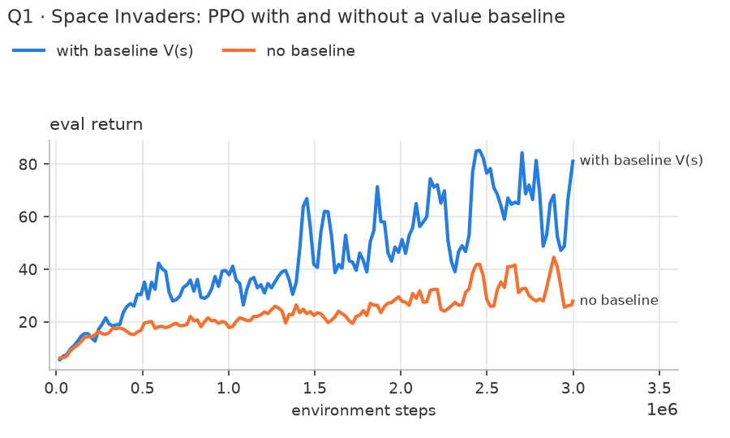
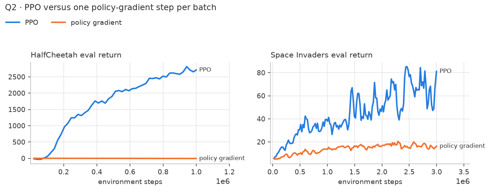
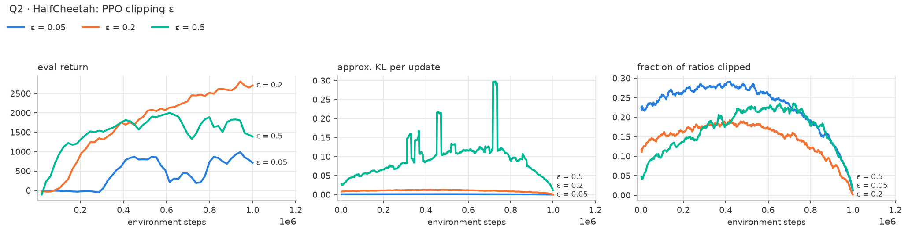
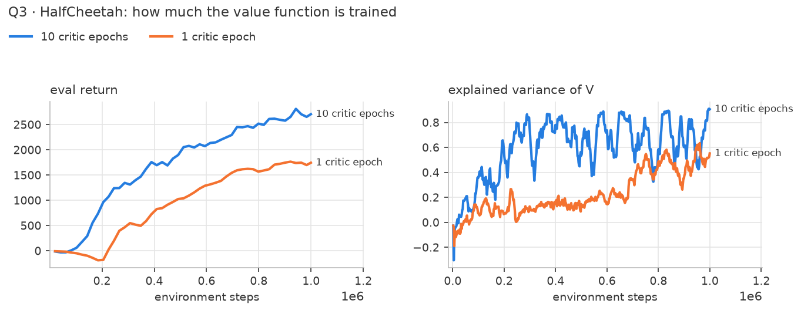

Français (English follows)

## Devoir 7 — PPO et fonction de valeur comme baseline

Dans ce devoir, vous implémentez le gradient de politique (REINFORCE), une fonction de valeur apprise $V_\phi(s)$ qui sert de baseline et l'objectif tronqué (*clipped*) de PPO. Vous les testez ensuite sur deux tâches : **HalfCheetah** (un robot simulé dans MuJoCo, actions continues) et **Space Invaders de MinAtar** (un jeu Atari miniature, images 10×10, actions discrètes).

Références : [PPO](https://arxiv.org/abs/1707.06347) (Schulman et al. 2017), [MinAtar](https://arxiv.org/abs/1903.03176) (Young et Tian 2019), [The 37 Implementation Details of PPO](https://iclr-blog-track.github.io/2022/03/25/ppo-implementation-details/).

### Environnement

Créez un environnement conda avec les librairies de `requirements.txt` :

```bash
conda create -n ift6758-hw7 python=3.10
conda activate ift6758-hw7
pip install -r requirements.txt
```

Tout tourne sur CPU ; un GPU n'aide pas pour des réseaux de cette taille.

### Consigne

Remplacez chaque `raise NotImplementedError` (marqué `# TODO`) dans ces deux fichiers :

| Fichier | Fonction | Ce qu'elle fait |
|---|---|---|
| `ppo/agents/ppo_agent.py` | `compute_discounted_returns` | rendement actualisé à partir de chaque pas (*reward-to-go*) |
| | `compute_advantages` | avantage $R_t - V_\phi(s_t)$ et cibles de la fonction de valeur |
| | `pg_loss` | perte du gradient de politique (REINFORCE) |
| | `ppo_clip_loss` | perte tronquée de PPO |
| | `PPOAgent.update` (TODO dans la boucle) | choisir la perte selon `alg.rl_alg` et ajouter le bonus d'entropie |
| `ppo/critics/value_critic.py` | `value_loss` | perte de régression de $V_\phi$, avec troncature optionnelle |
| | `ValueCritic.update` (TODO dans la boucle) | un pas de gradient sur la fonction de valeur |

Le reste du code (collecte des trajectoires, politique, réseau convolutif pour MinAtar, normalisation, journalisation) est fourni. Lisez le commentaire en haut de `ppo_agent.py` : il explique la forme `(T, N)` des tableaux et la convention de `dones`. Les épisodes coupés par une limite de temps sont déjà gérés.

**Respectez les formes et les types de retour de chaque docstring** : l'autograder les vérifie. Testez votre code avec les mêmes tests que l'autograder (le dernier entraîne PPO sur CartPole, environ une minute) :

```bash
python -m pytest tests -v
```

### Lancer des expériences

```bash
python run_ppo.py env=halfcheetah   env.exp_name=essai
python run_ppo.py env=spaceinvaders env.exp_name=essai
python run_ppo.py env=cartpole      env.exp_name=essai   # rapide, pour déboguer
```

`env=...` choisit un préréglage dans `conf/env/` (les hyperparamètres de chaque tâche). Les valeurs par défaut sont dans `conf/config.yaml`, et tout paramètre peut être changé depuis la ligne de commande, par exemple `alg.clip_coef=0.1`. Chaque exécution écrit `data/ppo_<exp_name>_<env>_<date>/log.csv`.

Pour tracer des courbes : `python plot_results.py --exps <préfixe1> <préfixe2> --metric eval/return --out fig.png`. Une courbe fait la moyenne de toutes les exécutions dont `exp_name` commence par le préfixe : nommez vos graines `..._s1`, `..._s2` et passez le préfixe `..._s`. Colonnes utiles de `log.csv` : `eval/return`, `train/episode_return`, `critic/explained_variance`, `policy/approx_kl`, `policy/clipfrac`, `policy/entropy`.

Durée sur CPU, avec 8 exécutions lancées en parallèle : environ 1 heure pour HalfCheetah (1M de pas) et 1 h 15 pour Space Invaders (3M de pas) par exécution. Lancez plusieurs exécutions en parallèle (une par cœur) et commencez tôt.

### Questions

Pour chaque question, mettez les figures demandées dans votre rapport avec une légende qui explique ce que vous observez. Une graine par réglage suffit ; plus de graines rendent vos conclusions plus fiables.

**Q1. La baseline (Space Invaders).** Entraînez PPO avec et sans fonction de valeur :

```bash
python run_ppo.py env=spaceinvaders env.exp_name=q1_baseline_s1
python run_ppo.py env=spaceinvaders env.exp_name=q1_nobaseline_s1 alg.use_baseline=false
```

Tracez `eval/return`. (a) Laquelle apprend le plus vite ? (b) Montrez que soustraire une baseline $b(s_t)$ ne change pas l'espérance du gradient. (c) Pourquoi la baseline réduit-elle la variance ?



*Exemple de courbes d'apprentissage (une graine, implémentation de référence). Vos courbes peuvent être différentes.*

**Q2. PPO contre le gradient de politique, et la troncature.**

```bash
python run_ppo.py env=halfcheetah   env.exp_name=q2_ppo_s1
python run_ppo.py env=halfcheetah   env.exp_name=q2_pg_s1 alg.rl_alg=pg
python run_ppo.py env=spaceinvaders env.exp_name=q2_pg_s1 alg.rl_alg=pg
python run_ppo.py env=halfcheetah   env.exp_name=q2_clip0.05_s1 alg.clip_coef=0.05
python run_ppo.py env=halfcheetah   env.exp_name=q2_clip0.5_s1  alg.clip_coef=0.5
```

Comparez le gradient de politique à PPO sur les deux tâches (pour Space Invaders, PPO est `q1_baseline`). Sur HalfCheetah, comparez ε ∈ {0.05, 0.2, 0.5} avec `eval/return`, `policy/approx_kl` et `policy/clipfrac`. (a) Pourquoi PPO peut-il faire plusieurs époques sur le même lot alors que le gradient de politique ne fait qu'un pas ? (b) Que se passe-t-il quand ε est trop petit ou trop grand ?





*Exemple de courbes d'apprentissage (une graine, implémentation de référence). Vos courbes peuvent être différentes.*

**Q3. Entraîner la fonction de valeur (HalfCheetah).**

```bash
python run_ppo.py env=halfcheetah env.exp_name=q3_critic1epoch_s1 alg.critic_update_epochs=1
```

Comparez avec `q2_ppo` (10 époques pour $V_\phi$). Tracez `eval/return` et `critic/explained_variance`. Comment la qualité de $V_\phi$ influence-t-elle l'apprentissage de la politique ? Que veut dire une variance expliquée proche de 0, ou négative ?



*Exemple de courbes d'apprentissage (une graine, implémentation de référence). Vos courbes peuvent être différentes.*

**Q4. Vos meilleurs agents.** Avec les meilleurs réglages trouvés, entraînez un agent final sur chaque tâche avec `logging.video=true` :

```bash
python run_ppo.py env=halfcheetah   env.exp_name=q4_best_s1 logging.video=true
python run_ppo.py env=spaceinvaders env.exp_name=q4_best_s1 logging.video=true
```

Mettez les courbes d'apprentissage dans le rapport et listez les paramètres que vous avez changés. La vidéo est dans `data/<exécution>/videos/final_policy.mp4`.

### Remise

1. **Gradescope, HW7 Code** : `ppo/agents/ppo_agent.py` et `ppo/critics/value_critic.py`. L'autograder lance les tests de `tests/test_ppo.py`.
2. **Gradescope, HW7** : le rapport PDF avec les figures et les réponses.
3. Un zip avec le dossier `data/` (seulement les exécutions `q1_` à `q4_`, avec les vidéos de Q4) et le script qui produit vos figures. Le script doit lire ses valeurs dans `data/`, sans valeurs codées en dur.

---

## Assignment 7 — PPO and a learned value-function baseline

In this assignment you implement the policy gradient (REINFORCE), a learned value function $V_\phi(s)$ used as the baseline, and the clipped objective of PPO. You then test them on two tasks: **HalfCheetah** (a simulated MuJoCo robot, continuous actions) and **MinAtar Space Invaders** (a miniature Atari game, 10×10 images, discrete actions).

References: [PPO](https://arxiv.org/abs/1707.06347) (Schulman et al. 2017), [MinAtar](https://arxiv.org/abs/1903.03176) (Young and Tian 2019), [The 37 Implementation Details of PPO](https://iclr-blog-track.github.io/2022/03/25/ppo-implementation-details/).

### Environment

Create a conda environment with the libraries listed in `requirements.txt`:

```bash
conda create -n ift6758-hw7 python=3.10
conda activate ift6758-hw7
pip install -r requirements.txt
```

Everything runs on CPU; a GPU does not help with networks this small.

### Instructions

Replace each `raise NotImplementedError` (marked `# TODO`) in these two files:

| File | Function | What it does |
|---|---|---|
| `ppo/agents/ppo_agent.py` | `compute_discounted_returns` | discounted reward-to-go |
| | `compute_advantages` | advantage $R_t - V_\phi(s_t)$ and value-function targets |
| | `pg_loss` | policy-gradient (REINFORCE) loss |
| | `ppo_clip_loss` | PPO clipped surrogate loss |
| | `PPOAgent.update` (TODO in the loop) | pick the loss from `alg.rl_alg` and add the entropy bonus |
| `ppo/critics/value_critic.py` | `value_loss` | regression loss for $V_\phi$, with optional clipping |
| | `ValueCritic.update` (TODO in the loop) | one gradient step on the value function |

The rest of the code (rollout collection, policy, the convolutional network for MinAtar, normalisation, logging) is given. Read the comment at the top of `ppo_agent.py`: it explains the `(T, N)` shape of the arrays and the convention for `dones`. Episodes cut off by a time limit are already handled.

**Match the shapes and return types in each docstring**: the autograder checks them. Test your code with the same tests the autograder runs (the last one trains PPO on CartPole, about a minute):

```bash
python -m pytest tests -v
```

### Running experiments

```bash
python run_ppo.py env=halfcheetah   env.exp_name=try
python run_ppo.py env=spaceinvaders env.exp_name=try
python run_ppo.py env=cartpole      env.exp_name=try   # fast, for debugging
```

`env=...` picks a preset in `conf/env/` (the hyperparameters for each task). Defaults are in `conf/config.yaml`, and any parameter can be overridden on the command line, e.g. `alg.clip_coef=0.1`. Each run writes `data/ppo_<exp_name>_<env>_<date>/log.csv`.

To plot curves: `python plot_results.py --exps <prefix1> <prefix2> --metric eval/return --out fig.png`. A curve averages all runs whose `exp_name` starts with the prefix, so name your seeds `..._s1`, `..._s2` and pass the prefix `..._s`. Useful columns in `log.csv`: `eval/return`, `train/episode_return`, `critic/explained_variance`, `policy/approx_kl`, `policy/clipfrac`, `policy/entropy`.

Time on CPU, with 8 runs going in parallel: about 1 hour for HalfCheetah (1M steps) and 1 h 15 for Space Invaders (3M steps) per run. Run several in parallel (one per core) and start early.

### Questions

For each question, put the requested figures in your report with a caption explaining what you observe. One seed per setting is enough; more seeds make your conclusions more reliable.

**Q1. The baseline (Space Invaders).** Train PPO with and without a value function:

```bash
python run_ppo.py env=spaceinvaders env.exp_name=q1_baseline_s1
python run_ppo.py env=spaceinvaders env.exp_name=q1_nobaseline_s1 alg.use_baseline=false
```

Plot `eval/return`. (a) Which learns faster? (b) Show that subtracting a baseline $b(s_t)$ does not change the expected gradient. (c) Why does the baseline reduce the variance?


*Example learning curves (one seed, reference implementation). Your curves may look different.*

**Q2. PPO versus the policy gradient, and clipping.**

```bash
python run_ppo.py env=halfcheetah   env.exp_name=q2_ppo_s1
python run_ppo.py env=halfcheetah   env.exp_name=q2_pg_s1 alg.rl_alg=pg
python run_ppo.py env=spaceinvaders env.exp_name=q2_pg_s1 alg.rl_alg=pg
python run_ppo.py env=halfcheetah   env.exp_name=q2_clip0.05_s1 alg.clip_coef=0.05
python run_ppo.py env=halfcheetah   env.exp_name=q2_clip0.5_s1  alg.clip_coef=0.5
```

Compare the policy gradient with PPO on both tasks (for Space Invaders, PPO is `q1_baseline`). On HalfCheetah, compare ε ∈ {0.05, 0.2, 0.5} using `eval/return`, `policy/approx_kl` and `policy/clipfrac`. (a) Why can PPO take several epochs on the same batch while the policy gradient takes only one step? (b) What happens when ε is too small or too large?


*Example learning curves (one seed, reference implementation). Your curves may look different.*

**Q3. Training the value function (HalfCheetah).**

```bash
python run_ppo.py env=halfcheetah env.exp_name=q3_critic1epoch_s1 alg.critic_update_epochs=1
```

Compare with `q2_ppo` (10 epochs for $V_\phi$). Plot `eval/return` and `critic/explained_variance`. How does the quality of $V_\phi$ affect policy learning? What does an explained variance near 0, or below 0, mean?


*Example learning curves (one seed, reference implementation). Your curves may look different.*

**Q4. Your best agents.** With the best settings you found, train a final agent on each task with `logging.video=true`:

```bash
python run_ppo.py env=halfcheetah   env.exp_name=q4_best_s1 logging.video=true
python run_ppo.py env=spaceinvaders env.exp_name=q4_best_s1 logging.video=true
```

Put the learning curves in the report and list the parameters you changed. The video is in `data/<run>/videos/final_policy.mp4`.

### Submission

1. **Gradescope, HW7 Code**: `ppo/agents/ppo_agent.py` and `ppo/critics/value_critic.py`. The autograder runs the tests in `tests/test_ppo.py`.
2. **Gradescope, HW7**: the PDF report with the figures and answers.
3. A zip with the `data/` folder (only the `q1_` to `q4_` runs, with the Q4 videos) and the script that produces your figures. The script must read its values from `data/`, with no hard-coded values.
